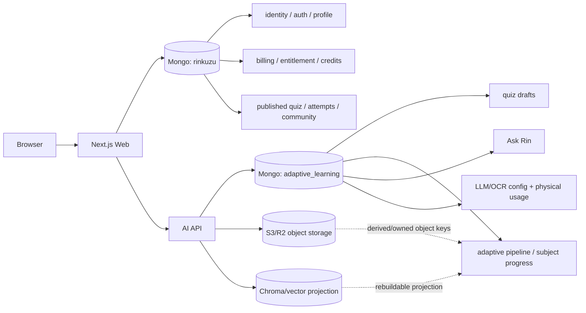

# RinKuzu System Architecture Audit — 2026-08-24

## Status

This report preserves the baseline evidence gathered before cutover work. The 2026-08-25 implementation removed the duplicate runtime authorities and generation-prefixed first-party routes from both repositories. Production data deletion and deployment remain a coordinated maintenance action; neither has been executed as part of this report.

The latest read-only production audit found one deliberate entitlement disagreement: `hantram3012@gmail.com` has a canonical paid/fulfilled `Plus` grant ending 2026-09-22 and a later admin-created legacy `Eco Plus` snapshot ending 2027-02-24. The owner approved discarding the legacy snapshot and will issue a new canonical admin grant later. The cutover migration requires an explicit mismatch-discard flag and cannot silently choose between them.

The source-of-truth decisions are normative in `docs/architecture/source-of-truth-registry.md`.

## Repositories and GitNexus

- Web: `rinkuzu`, GitNexus index rebuilt successfully after stale FTS metadata was removed/recreated.
- AI API: `rinkuzu-ai-api`, GitNexus index rebuilt successfully after the same stale FTS failure.
- Web index after rebuild: 12,099 nodes, 28,450 edges, 750 clusters, 300 flows.
- AI index after rebuild: 8,488 nodes, 16,074 edges, 274 clusters, 300 flows.
- GitNexus impact for `resolveEntitlements`: CRITICAL, 35 impacted symbols, including adaptive, premium, storage and LLM quota flows.
- GitNexus impact for `SubscriptionService`: CRITICAL, 38 impacted symbols.
- GitNexus impact for `BillingRepository.computeQuote`: LOW.
- GitNexus impact for `BillingRepository.fulfillOrder`: LOW.

Because the two CRITICAL symbols are shared authorization boundaries, they must only be cut over together with entitlement/admin-grant regression coverage. Silently switching one caller at a time would create another dual-runtime period.

## Runtime inventory

### Web

Observed inventory from `src`:

- 129 Next.js API route handlers.
- 61 Next.js pages.
- 41 repository TypeScript files including repository tests; production repositories include billing, subscription, user/account/auth, quiz, attempt/progress, bookmark, folder, discussion/report, premium and admin repositories.
- Mongo models include user, plan, subscription, billing facts/projections, quiz, attempt, quiz/question/user progress, bookmark, folder membership, discussion/report, credit wallet/ledger, premium access/submission/review/play-session, audit/admin fences and abuse controls.

### AI API

Canonical Beanie collection names found in code:

- `al_pipeline_jobs`
- `al_subject_progress`
- `quiz_drafts`
- `al_document_ocr_records`
- `al_document_chunks`
- `ocr_provider_keys`
- `ocr_provider_configs`
- `llm_usage`
- `llm_config_revisions`
- `llm_config_state`
- `llm_credential_secrets`
- `llm_credential_health`
- `llm_config_audit`
- `ask_rin_conversations`
- `ask_rin_messages`
- `ask_rin_requests`

AI Mongo bootstrap currently selects database `adaptive_learning` explicitly in `api/shared/mongo_store.py`. `Settings` contains `MONGODB_URI` but no separate database-name setting, so a database name embedded in the URI is not the runtime selector.

## Persistence ownership discovered

Current local configuration points both services at the same MongoDB Atlas host, but Web selects database `rinkuzu` while AI runtime explicitly selects `adaptive_learning`.

## Confirmed duplicate / competing runtime authorities

### 1. Premium entitlement

The baseline runtime had four competing representations:

1. `users.subscription`
2. `subscriptions`
3. billing/payment facts (`billingorders`, `paymentattempts`, `paymenttransactions`)
4. entitlement ledger/projection (`entitlementgrants`, `entitlementadjustments`, `entitlementaccounts`)

Confirmed code paths:

- `resolveEntitlements()` still delegates to `SubscriptionService.isUserPremium()`.
- `SubscriptionService` reads `users.subscription`, including lazy expiration behavior involving `subscriptions`.
- `BillingRepository.fulfillOrder()` creates/replays entitlement grants into `entitlementaccounts` and then also writes `users.subscription` in the same fulfillment flow.
- `BillingRepository.computeQuote()` checks the entitlement projection but still falls back to embedded `users.subscription` for perpetual state.
- First-purchase promotion eligibility checks canonical billing order facts and also `Subscription.exists(...)` as a legacy fallback.
- `AdminBillingRepository.addUserSubscriptionGrant()` writes `users.subscription` plus a `subscriptions` row but does not create a canonical entitlement grant.
- Admin subscription listing reads `subscriptions`, while admin user views expose the embedded user subscription snapshot.

This is a real dual-read/dual-write condition, not merely dead code.

Target: `entitlementgrants` + `entitlementadjustments` are facts; `entitlementaccounts` is a deterministic projection. `users.subscription` and `subscriptions` become migration-only inputs and then are removed from runtime.

### 2. Payment/subscription HTTP flow

The baseline source contained two payment generations:

- Current checkout client used a generation-prefixed billing namespace.
- Older payment flow: `/api/subscription/create-payment`, `/verify`, `/cancel-payment`, `/webhook`.
- Older callback pages: `/payment/success`, `/payment/cancel`.
- Current checkout page: `/checkout`.
- The subscription page still calls `/api/subscription/plans` and `/api/subscription/status`.
- The proxy CSRF exception still names `/api/subscription/webhook`.

Target: one first-party billing namespace without implementation generation suffix, `/api/billing/*`, and one entitlement/status query backed by canonical entitlement projection. Remove the old handlers/pages in the same cutover release.

### 3. Bookmark authority

`bookmarks` stores user id + quiz/question snapshots/indexes. `questionprogresses` independently stores `isBookmarked` while also holding SRS state. Those can drift and must not both decide bookmark state.

Target: `bookmarks` is authority; `questionprogresses.isBookmarked` is removed or treated as a rebuildable projection during migration.

### 4. Credit balance

`creditledgers` contains immutable ledger deltas and `balanceAfter`; `creditwallets.balance` is mutable aggregate state.

Target: ledger is authority, wallet balance is a projection. CI reconciliation proves wallet equals ledger replay.

### 5. Attempt/progress state

`attempts` keeps immutable submission facts and a historical quiz snapshot. Separate `quizprogresses`, `questionprogresses` and `userprogresses` represent resumable/review/aggregate state.

Target: attempts remain immutable history; resumable progress has one mutable owner; summaries are explicitly derived. Attempt quiz snapshots preserve history only and never override current `quizzes`.

### 6. Web versus AI ownership

Web proxies quiz draft/adaptive/Ask Rin calls to AI while identity and entitlement are established by Web. AI persists its own domain state in `adaptive_learning`.

Target: Web owns user identity, published quiz, commerce/access, ordinary attempts/progress/community. AI owns draft generation, adaptive state, Ask Rin, LLM/OCR runtime configuration and AI processing artifacts. AI must not create a second user/profile authority.

## Versioned/legacy runtime inventory at baseline

First-party Web debt confirmed:

- generation-prefixed billing routes
- `/api/subscription/*` payment generation
- `/payment/success`
- `/payment/cancel`
- `SubscriptionService`, `SubscriptionPaymentService`, `SubscriptionActivationService`, `SubscriptionRepository` participating in runtime
- `Subscription` model used as mutable/query authority
- `users.subscription` runtime reads/writes
- fallback variable/path semantics such as `legacyPaidSubscription`

AI previously exposed generation-prefixed first-party routes and Web generated/contracts against those routes. The cutover updated AI route definitions, generated OpenAPI contract and Web proxy callers together, without aliases.

Historical-data compatibility strings (for example old report rows, old password hashes or archived migrations) are not automatically runtime-generation violations when they do not form an alternate business flow. They need an explicit migration/removal policy instead of broad string replacement.

## Production/read-only verification status

### AI health

`GET https://linhdzqua148-rinkuzu-ai-api.hf.space/health` returned HTTP **503** on 2026-08-24 during this audit. The previously observed outage/degraded state therefore remains reproducible.

### MongoDB

A read-only connection attempt from the Local Coder host failed during DNS SRV resolution with `ECONNREFUSED` for the Atlas SRV lookup. No database command was executed and no production data was changed.

Because production Mongo could not be reached, this report intentionally does **not** invent anomaly counts. `scripts/audit-system-consistency.mjs` was added so the same audit can run deterministically once read-only connectivity is restored. It emits JSON, hashes sample identifiers and performs only read/list/aggregate operations.

Checks implemented in the audit script include:

- duplicate canonical email
- expired embedded active subscription
- paid order not fulfilled
- fulfilled paid order without entitlement grant
- billing-sourced entitlement grant without billing order
- entitlement account with missing user
- credit wallet/ledger drift
- orphan bookmark, folder membership and attempt references
- bookmark projection drift
- adaptive subject progress without pipeline job
- document chunks without pipeline job
- Ask Rin messages without conversation
- LLM active pointer without a matching config revision

Object-store existence/orphan checking still requires a read-only object-list/head capability and is not executed by the current Mongo-only script.

## Cutover plan

### Wave A — Evidence and guardrails

1. Keep the source-of-truth registry normative.
2. Run `scripts/audit-system-consistency.mjs` against production read-only once DNS/network access works.
3. Run architecture guard in report mode and capture all current first-party generation/authority violations.
4. Add fixture/test DB execution for the consistency audit.

Rollback: documentation/scripts only; no runtime behavior change.

### Wave B — Entitlement authority

1. Introduce one entitlement repository/service over grant/adjustment facts plus account projection.
2. Add reconciliation tests proving replay -> `entitlementaccounts` exactly.
3. Change `resolveEntitlements` to canonical entitlement projection/facts only.
4. Remove `users.subscription` writes from billing fulfillment.
5. Remove `Subscription` and `users.subscription` fallback reads from quote/first-purchase logic.
6. Change admin grant to create a `manual` entitlement grant through the same domain service used by billing fulfillment.
7. Change admin subscription views to read canonical entitlement data.
8. Add expiry/cancel/refund/admin-grant invariant tests through the same entitlement mutation boundary.

Rollback: code rollback plus projection rebuild from ledger; no need to restore dual writes. Production legacy rows remain untouched until approved migration.

### Wave C — Billing route cutover

1. Move billing to `/api/billing/*`.
2. Update all Web callers and idempotency endpoint metadata in one release.
3. Replace subscription plans/status callers with canonical billing/entitlement APIs.
4. Delete `/api/subscription/create-payment|verify|cancel-payment|webhook` and related old payment services.
5. Delete `/payment/success` and `/payment/cancel`; callbacks return to `/checkout` only.
6. Remove old CSRF exception and obsolete tests/contracts.

No compatibility alias is retained. Rollback is a full application release rollback, not parallel routes.

### Wave D — Credits, bookmarks, attempts/progress

1. Credit wallet becomes ledger projection with rebuild/reconciliation command.
2. Bookmark reads/writes use `bookmarks` only; migrate/remove `questionprogresses.isBookmarked`.
3. Define one resumable progress owner and one aggregation path from attempts/review facts.
4. Add orphan/reference and reconstruction tests.

### Wave E — Web ↔ AI contract

1. Make AI Mongo database name an explicit canonical configuration setting with default/current value `adaptive_learning`; reject conflicting selectors rather than silently choosing two.
2. Remove first-party route generation prefixes atomically in AI + OpenAPI + Web generated contract/proxies.
3. Validate identity context ownership and prevent AI user/profile persistence from appearing.
4. Define DB ownership tests by collection name.

### Wave F — Storage and final cleanup

1. Inventory DB-owned S3/R2 keys read-only.
2. Validate missing objects and ownerless objects.
3. Ensure cache/Chroma can be rebuilt and never decides job completion independently.
4. After approved production migration/reconciliation, stop all reads/writes of migration-only collections/fields and request approval before deleting production data or objects.

## Required invariants after cutover

- A paid/fulfilled billing order that grants Premium has exactly one idempotent source entitlement grant.
- Every billing-sourced grant resolves to a valid billing source.
- `entitlementaccounts` equals deterministic ledger replay.
- Expiry, cancellation, refund/chargeback and admin grants change entitlement through one domain boundary.
- Wallet balance equals credit ledger replay.
- Bookmark state has one authority.
- Attempt snapshots are historical only.
- Adaptive/Ask Rin jobs/messages have valid owners and source records.
- AI provider physical usage is distinct from Web user entitlement/quota usage.
- S3/R2 and vector data are owned/rebuildable projections where specified.

## Production actions status

The owner approved deleting legacy subscription data and discarding the identified `Eco Plus` snapshot on 2026-08-25. The Web cutover was deployed to production at commit `f5ae49ce`, then migration checksum `0edda77cc6fbd41360665cb9eda95c94e5831c0d4ad5639fe025236032d42567` was applied.

- The canonical `Plus` entitlement for `hantram3012@gmail.com` was retained; its conflicting embedded `Eco Plus` snapshot was removed.
- `users.subscription`, `questionprogresses.isBookmarked`, and `quizzes.folder` now have zero remaining fields.
- `subscriptions` and `premiumreviewjobs` were deleted rather than archived.
- Valid folder placement was moved to `folderquizzes`; canonical bookmarks were preserved.
- The post-cutover verifier passed and production HTTP smoke checks returned 200 for the home, pricing, Premium catalog, and billing-plan endpoints.
- HF Space remains unavailable because billing is disabled, but it is not an authority for Web identity, billing, entitlements, credits, or Premium quiz delivery.
- A plan-SHA-locked transactional cleanup deleted 23 attempts whose source quizzes no longer existed; the post-cleanup orphan graph is empty.

## Files added in Wave A

- `docs/architecture/source-of-truth-registry.md`
- `docs/architecture/system-audit-2026-08-24.md`
- `scripts/audit-system-consistency.mjs`
- `scripts/check-source-of-truth-architecture.mjs`

No commit or push has been made.
